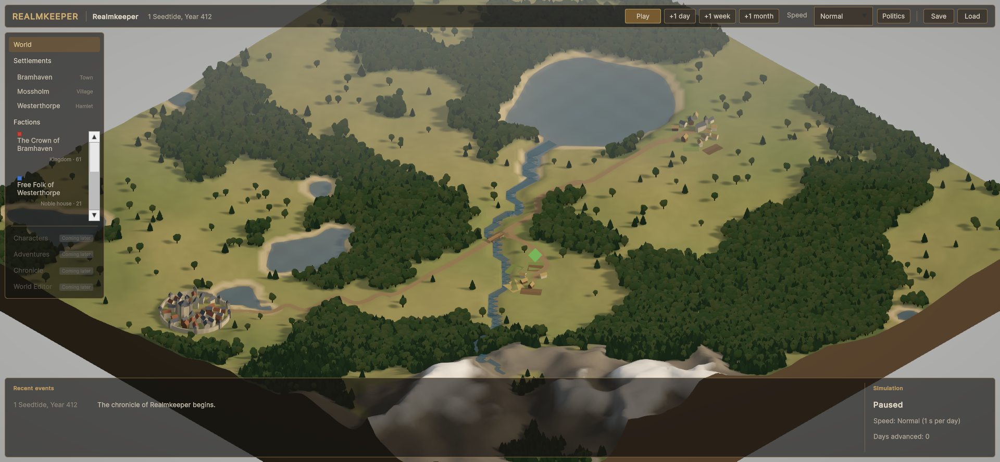

# Realmkeeper

Realmkeeper is a persistent fantasy world simulation and exploration platform: a seeded
medieval world that lives on through deterministic daily simulation. Today it is presented as
a stylized-realistic isometric 3D strategic map. The long-term direction (binding) adds
first- and third-person exploration of the same settlements, backed by the same single
simulation. See the [Product foundation](Documentation/Product/ProductFoundation.md).

This repository is an independent project. It shares no code, assets, packages or
assemblies with any other Unity project, including Living Realms and The Tavern Table.

> **Status: Phase 2 (settlement economies) complete.**
> Settlements have terrain-derived production, labour, storage, consumption and shortages.
> They trade real goods along the roads, and prosperity, stability and population follow
> documented formulas. A structured chronicle records what happens. Tested in Unity
> 6000.0.47f1: 110 EditMode and 17 PlayMode tests passing. See
> [Documentation/Testing/TestResults.md](Documentation/Testing/TestResults.md) and
> [Economy](Documentation/Systems/Economy.md).



## Unity version

**Unity 6000.0.47f1** (Unity 6.0 LTS line) with the Universal Render Pipeline.
`ProjectSettings/` and `Packages/` are copied from a Unity-generated *Universal 3D*
template project created with that version (see the handoff document); they are not
hand-written.

## What works today

| Area | State | Evidence |
|---|---|---|
| Seven assembly definitions with enforced dependency rules | Implemented | Mirrored by the .NET harness; compiled by Unity 6000.0.47f1 |
| Domain models (world, settlements, resources, calendar, IDs, geography) | Implemented | Compiled and tested (.NET 8, C# 9, netstandard2.1) |
| Deterministic daily simulation (scheduler + 7 economy systems, no randomness in rules) | Implemented | Tested (determinism, 7 × 1 day = 7 days, failed days roll back) |
| Settlement economy: 5 resources, labour, production, storage, consumption, shortages (Phase 2) | Implemented | 10 EditMode tests + inspector PlayMode test |
| Trade routes moving real goods with conservation checks (Phase 2) | Implemented | 9 EditMode tests incl. 200-day conservation; mutation-checked |
| Explainable prosperity, stability and population (Phase 2) | Implemented | 7 EditMode tests |
| Structured chronicle with formatted summaries, persisted (Phase 2) | Implemented | EditMode and PlayMode save/load tests |
| Seed-based region generation (terrain, forest, mountains, lake, river, 3 settlements, roads) | Implemented | Tested across 12 seeds |
| Versioned local JSON save/load | Implemented | Tested |
| Application commands, queries and real-time playback pacing | Implemented | Tested |
| Unity scene, 3D terrain rendering, isometric camera (Stage E) | Implemented | PlayMode tests (world, terrain, pan, zoom, rotate) |
| Settlement selection, inspector, UI Toolkit interface (Stage F) | Implemented | PlayMode tests (select, inspector, clear, +1 week, play/pause) |
| PlayMode tests | Implemented | 17 passing in Unity 6000.0.47f1 |

## Repository layout

```
Assets/Realmkeeper/
  Runtime/
    Domain/          Realmkeeper.Domain          data models, IDs, calendar, geography, validation
    Simulation/      Realmkeeper.Simulation      scheduler and daily systems
    Application/     Realmkeeper.Application     commands, queries, WorldSession, ports
    Infrastructure/  Realmkeeper.Infrastructure  RNG, generation, JSON persistence, composition root
    Presentation/    Realmkeeper.Presentation    bootstrap, world visuals, shaders, lighting, isometric camera,
                                                 selection, UI Toolkit HUD (UI/Resources: UXML, USS, theme)
  Scenes/            Realmkeeper.unity           the single scene (everything else is built at runtime)
  Tests/
    EditMode/        Realmkeeper.Tests.EditMode  110 cases (Phase2/ holds the economy, trade and chronicle tests)
    PlayMode/        Realmkeeper.Tests.PlayMode  17 tests: world, camera, selection, HUD, economy UI
Tools/DotNet/        Out-of-Unity build and test harness (mirrors the .asmdef graph)
Documentation/       Architecture, systems, testing, decisions, handoff
```

## Setup

### Verify the core without Unity (any OS with the .NET 8 SDK)

```bash
Tools/DotNet/verify.sh
```

This compiles Domain, Simulation, Application and Infrastructure at Unity's language level
(C# 9, .NET Standard 2.1), with warnings treated as errors, and runs every EditMode test
under NUnit 3. Results are written to `Tools/DotNet/TestResults/`.

### Open in Unity

Open the repository root (`C:\Dev\Realmkeeper` on the development PC) in Unity Hub with
6000.0.47f1, then open `Assets/Realmkeeper/Scenes/Realmkeeper.unity` and press Play.

### Run the Unity tests without the editor open

```bash
Unity -batchmode -projectPath . -runTests -testPlatform EditMode -testResults EditMode.xml
Unity -batchmode -projectPath . -runTests -testPlatform PlayMode -testResults PlayMode.xml
```

## Known limitations

- Generation uses single-precision floats. Results are reproducible on one platform, and
  very likely on all IEEE-754 x64/ARM64 runtimes, but this has not been verified across
  Mono, IL2CPP and CoreCLR.
- Terrain is not saved: it is rebuilt from seed and generator version on load. A save made
  with a different generator version is refused, not migrated.
- One region of 128 × 128 cells, three settlements, two factions and no NPCs.
- Economy balance is tuned on six seeds. Some seeds produce a struggling town (by design),
  and balance across many more seeds has not been studied.
- No seasons, construction, diplomacy or military yet. Trade routes follow the generated roads only.
- The HUD's layout was checked by eye at one resolution (about 1707 × 875); no automated layout test exists.

## Documentation

- [Product foundation](Documentation/Product/ProductFoundation.md), including the binding
  dual-perspective addendum
- [Architecture overview](Documentation/Architecture/Overview.md)
- [Assembly dependencies](Documentation/Architecture/AssemblyDependencies.md)
- [Simulation lifecycle](Documentation/Architecture/SimulationLifecycle.md)
- [Data ownership](Documentation/Architecture/DataOwnership.md)
- Systems: [Economy and trade](Documentation/Systems/Economy.md) ·
  [World generation](Documentation/Systems/WorldGeneration.md) ·
  [Simulation scheduling](Documentation/Systems/SimulationScheduling.md) ·
  [Persistence](Documentation/Systems/Persistence.md)
- Testing: [How to run](Documentation/Testing/RunningTests.md) ·
  [Results](Documentation/Testing/TestResults.md) ·
  [Untested areas](Documentation/Testing/UntestedAreas.md)
- [Architectural decision records](Documentation/Decisions/README.md)

## Credits

Rules material from the System Reference Document 5.2.1 and 5.1 by Wizards of the Coast LLC (CC BY 4.0); CC0 art by Quaternius and ambientCG. Full attribution: [CREDITS.md](CREDITS.md) (also shown in the game, in the Player Hub's Info section).
